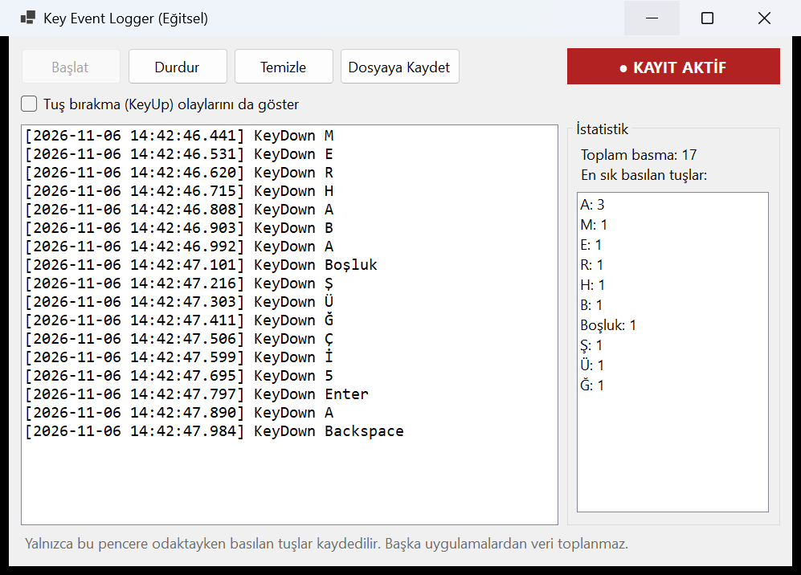
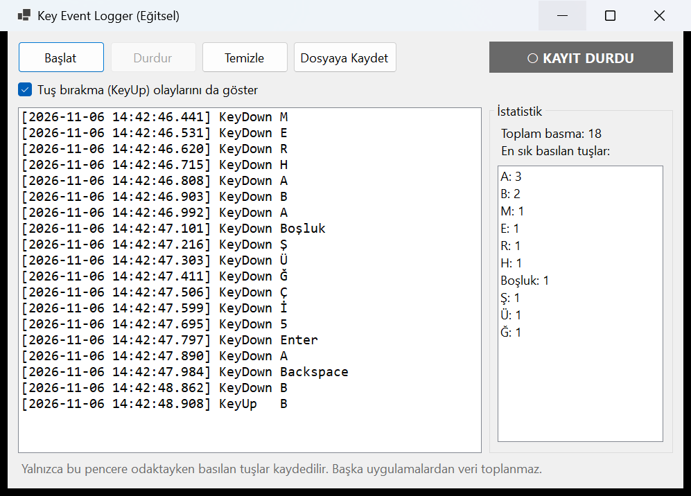

# YMH219-KeyEventLogger

Windows Forms'ta klavye olaylarının nasıl yakalandığını ve işlendiğini gösteren eğitsel bir uygulama. Uygulama **yalnızca kendi penceresi odaktayken** basılan tuşları, zaman bilgisiyle birlikte listeler ve istenirse yerel bir `.txt` dosyasına kaydeder.

Nesne Tabanlı Programlama (YMH 219) dersi ek uygulama ödevidir.

## Kullanılan Teknolojiler

- C# / .NET 10
- Windows Forms
- Harici NuGet paketi yoktur

## Kurulum ve Çalıştırma

Gereksinimler: Windows, .NET 10 SDK (Visual Studio 2026 ".NET masaüstü geliştirme" iş yüküyle birlikte gelir).

**Visual Studio ile:** `KeyEventLogger.slnx` dosyasını açın ve `Ctrl+F5` ile çalıştırın.

**Komut satırıyla:**

```bash
git clone https://github.com/Ebubekir23/YMH219-KeyEventLogger.git
cd YMH219-KeyEventLogger
dotnet run --project KeyEventLogger
```

## Özellikler

- **Başlat / Durdur:** Kayıt durumunu kontrol eder. Kırmızı/gri gösterge kaydın açık olup olmadığını gösterir.
- **Tuş kaydı:** Tuş adı ve milisaniyeli zaman bilgisi listede görünür. Türkçe tuşlar (Ş, Ğ, Ü, İ...) ve `Ctrl+A` gibi kombinasyonlar okunabilir adlarla yazılır.
- **KeyUp seçeneği:** İstenirse tuş bırakma olayları da listelenir.
- **Temizle:** Ekrandaki kayıtları ve istatistikleri siler.
- **Dosyaya Kaydet:** Kayıtları kullanıcının seçtiği `.txt` dosyasına yazar. Yazma hatası olursa uygulama kapanmaz, hata mesajı gösterilir.
- **İstatistik:** Toplam basma sayısı ve en sık basılan 10 tuş.

## Sınıf Yapısı

| Sınıf | Görevi |
|---|---|
| `Models/TusKaydi` | Tek bir klavye olayı (zaman, tuş adı, olay türü) |
| `Models/KayitOturumu` | Kayıt durumu, kayıt listesi ve istatistik hesapları |
| `Services/TusAdiCozucu` | `KeyEventArgs` bilgisini okunabilir tuş adına çevirir |
| `Services/DosyaKaydedici` | Kayıtları `StreamWriter` ile dosyaya yazar |
| `AnaForm` | Arayüz ve klavye olayları (`KeyDown`, `KeyUp`, `KeyPreview`) |

## Ekran Görüntüleri

Kayıt açıkken:



Kayıt durmuş ve KeyUp olayları açıkken:



## Kapsam ve Güvenlik Sınırı

Bu uygulama gerçek bir sistem keylogger'ı değildir. Global klavye kancası kullanmaz; arka planda veya gizli çalışmaz, başlangıçta otomatik açılmaz, başka uygulamalardan veri toplamaz ve kayıtları ağ üzerinden göndermez. Pencere odakta değilken hiçbir tuş yakalanmaz.

## Bilinen Sınırlamalar

- Kayıt açıkken klavye butonları tetiklemez; kaydı durdurmak için fare kullanılır.
- Basılı tutulan tuş tek kayıt sayılır.
- `Alt+F4` pencereyi kapatmak için ayrılmıştır ve kaydedilmez.
- Windows'un kendisinin yakaladığı `Alt+Tab` ve `Win` kısayolları uygulamaya ulaşmayabilir.
- Yalnızca Windows'ta çalışır.

## Geliştirici

Ebubekir Yılmaz – 250541051
